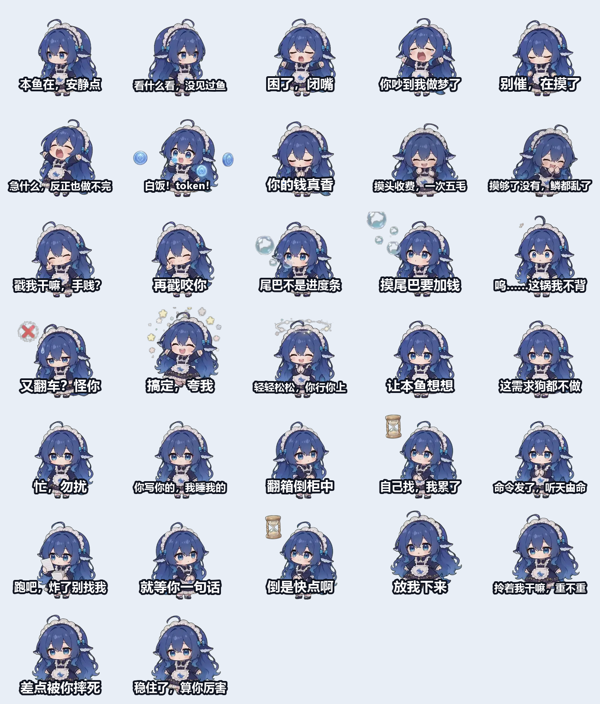

# 大肥鱼表情包

鲸鱼娘「大肥鱼」的聊天表情包：**32 张静态 PNG + 16 个动态 GIF**，共 7 MB。

## 长什么样



## 内容

| 类别 | 数量 | 说明 |
|---|---|---|
| 静态 | 32 | 每种动作两套配文 |
| 动图 | 16 | 每种动作一支，12 FPS |

配文走「毒舌」路线，适合拿来怼同事、怼甲方、怼自己。

## 目录

```
stickers/          表情包本体（.png 静态 / .gif 动图）
preview.png        全部静态表情的总览图
tools/make_stickers.py  生成脚本（可自行改配文重新生成）
```

## 怎么用

- **微信/QQ**：直接把 `.gif` 拖进聊天窗口
- **抖音/小红书**：静态图可直接当贴纸或封面素材
- **自定义**：改 `tools/make_stickers.py` 里的 `CAPTIONS` 字典，重跑即可

```bash
pip install pillow numpy
python tools/make_stickers.py
```

## 素材来源与许可

角色素材来自 [PC2005-cloud/dsh-pet](https://github.com/PC2005-cloud/dsh-pet)，
**MIT License**，版权归原作者。本仓库只做表情包的排版与配文，
同样以 MIT 协议发布，转载时请保留致谢。